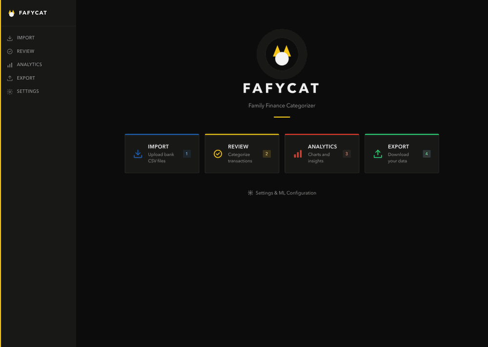
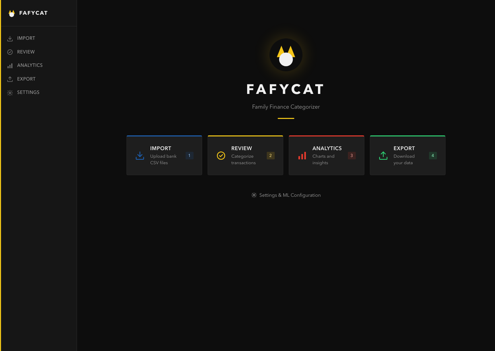
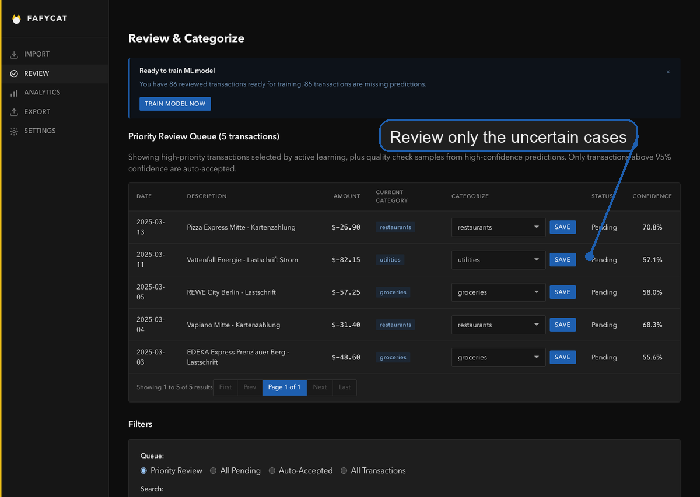
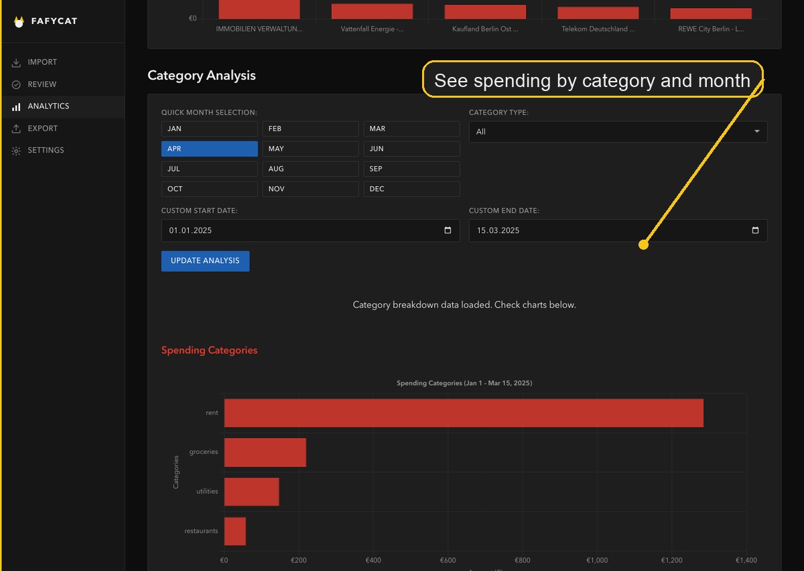

# 🐱 FafyCat - Local-First Transaction Categorization

FafyCat is a privacy-focused financial transaction categorization tool that uses local machine learning to organize your banking CSV exports. Your transaction data stays on your device: no account linking, no hosted backend, and no cloud copy of your financial history.

<p align="center">
  
</p>

<p align="center">
  <em>Import bank CSVs, let the local model predict categories, review the uncertain cases, and explore the results.</em>
</p>

<p align="center">
  
  
  
</p>

## ✨ Key Features

- **🤖 Smart Categorization**: Machine learning categorizes transactions from your own reviewed history
- **🔒 Privacy First**: Transaction data stays on your device, with local static assets and no hosted backend
- **📊 Transparent Review**: Confident predictions are auto-accepted; everything else lands in one review queue, ordered so one review resolves the most
- **🏪 Merchant Memory**: Learns from your patterns to improve over time
- **📈 Export Ready**: Multiple export formats for your favorite analysis tools
- **⚡ Fast & Efficient**: Process thousands of transactions in seconds

## 🚀 Quick Start

### Prerequisites

- Python 3.13 or later
- uv package manager https://docs.astral.sh/uv/getting-started/installation/

### Installation

1. **Install with uv**
   ```bash
   uv tool install git+https://github.com/davidchris/fafycat
   ```

2. **Or clone for development**
   ```bash
   git clone https://github.com/davidchris/fafycat.git
   cd fafycat
   uv sync
   ```

3. **Start the application**
   ```bash
   # Start the packaged app
   fafycat serve

   # Development mode with sample data and hot reload
   fafycat serve --dev

   # If developing from a cloned checkout
   uv run fafycat serve --dev
   ```

4. **Open your browser**
   - Development: http://localhost:8001
   - Production: http://localhost:8000

## 📋 Getting Started Guide

### First Time Setup

1. **Import Your Data**
   - Navigate to the Import page
   - Upload your bank transaction CSV files
   - The system auto-detects column formats

2. **Review & Categorize**
   - Go to the Review page
   - Correct any miscategorized transactions
   - The system learns from your corrections

3. **Train the Model**
   - Visit Settings → Train Model
   - Click "Train ML Model Now"
   - Training takes seconds to minutes
   - Transactions without a prediction are predicted right after training

4. **Enjoy Automation**
   - Future imports will be auto-categorized
   - Only review uncertain predictions
   - Export data for analysis

### Using Labeled Historical Data

If you have previously categorized transactions:

```bash
# Import your labeled data
uv run python scripts/import_labeled_data.py --data-path /path/to/your/data

# Or use the reset script for a fresh start
uv run python scripts/reset_and_import.py --labeled-data-path /path/to/your/data --train-model
```

#### Where do I get my banking transactions from?

- I'm getting mine via the [MoneyMoney App](https://moneymoney.app).

## 🏗️ Architecture

```
┌─────────────────┐
│   CSV Import    │ → Flexible format detection
└────────┬────────┘
         │
         ▼
┌─────────────────┐     ┌──────────────────┐
│ Feature Extract │────▶│  ML Prediction   │
│  - Merchants    │     │  - LightGBM      │
│  - Amounts      │     │  - Naive Bayes   │
│  - Patterns     │     │  - Ensemble      │
└─────────────────┘     └──────────────────┘
                                 │
                                 ▼
                        ┌──────────────────┐
                        │   Review UI      │
                        │  Single queue    │
                        └──────────────────┘
                                 │
                                 ▼
                        ┌──────────────────┐
                        │   Data Export    │
                        │ CSV/Excel/JSON   │
                        └──────────────────┘
```

## 📊 Supported CSV Formats

FafyCat reads a CSV by its column headers and detects the file layout:

- **Layout**: comma, semicolon or tab separated; UTF-8 (with or without BOM) or Windows-1252/Latin-1; account details above the header row are skipped
- **Date**: `YYYY-MM-DD`, `DD.MM.YYYY`, `DD.MM.YY`, and `DD/MM/YYYY` or `MM/DD/YYYY`. The day/month order of slash dates is read from the file; when no date shows it, the import stops and asks for the order (`--date-order dmy|mdy` on the CLI, a select on the Import page)
- **Amount**: one signed column (negative for expenses), with a decimal comma (`1.234,56`) or a decimal point (`1,234.56`). Separate debit/credit columns are not supported
- **Description**: payee or merchant name and purpose (e.g. `Verwendungszweck`)
- **Category**: optional. A label that names an existing category imports the row as reviewed; other rows go to review

Tested with synthetic files shaped like Sparkasse (CSV-CAMT V2) and DKB (2023 layout) exports; see `tests/fixtures/bank_exports/`. Other exports work when their headers match the names FafyCat knows (`src/fafycat/data/csv_processor.py`).

## 🎯 How It Works

### Smart Learning System

1. **Initial Training**: Learn from your categorized transactions
2. **Prediction**: Automatically categorize new transactions
3. **Review Queue**: Everything below the auto-approve threshold waits for you, merchants with many pending rows and uncertain predictions first
4. **Continuous Improvement**: Learn from corrections over time

### Privacy & Security

- **Local Processing**: All ML models run on your device
- **No Account Linking**: Import CSV exports instead of connecting bank accounts
- **No Hosted Backend**: The web UI is served by your local FafyCat process
- **Your Data**: You own and control all your financial data
- **Open Source**: Fully auditable codebase
- **Loopback Only by Default**: The server binds to `127.0.0.1` and has **no authentication**. It answers only to the
  host names `localhost`, `127.0.0.1` and `::1` (blocks DNS rebinding) and rejects any POST/PUT/PATCH/DELETE whose
  `Origin` or `Referer` is another site (blocks cross-site request forgery). `fafycat serve --host <address>` exposes
  every transaction to anyone who can reach that address and prints a warning; that address is allowed automatically.
  To allow more host names (for example a LAN name), set `FAFYCAT_ALLOWED_HOSTS=fafycat.lan,192.168.1.20`.

## 🤖 Use with Coding Agents

FafyCat ships a small read-only CLI surface (transactions, categories, budgets, analytics) that is designed for use by coding agents like Claude Code. Every command emits JSON. A bundled Claude Code skill is one command away:

```bash
fafycat skill install
```

See [docs/coding-agents.md](docs/coding-agents.md) for the full guide.

## 🛠️ Configuration

### Where your data lives

Every command (`serve`, `import`, `init`, `status`, and the query commands) opens the same database
for the same flags and environment:

| Mode | Database |
|------|----------|
| Production (default) | `<data dir>/fafycat_prod.db` |
| Development (`--dev`) | `<data dir>/fafycat_dev.db`, seeded with synthetic data by `fafycat serve --dev` |

`--data-dir` and `--dev` work with every command, at any position: `fafycat --dev tx list`,
`fafycat serve --dev`, `fafycat import file.csv --data-dir /path`.

The data dir is the first of: `--data-dir`, `FAFYCAT_DATA_DIR`, `[paths] data_dir` in
`~/.config/fafycat/config.toml` (or the file named by `FAFYCAT_CONFIG`), and the platform user-data
directory (`~/Library/Application Support/fafycat` on macOS, `~/.local/share/fafycat` on Linux).

The database follows the same rule, command-line flag > environment > config file > default:

1. `--data-dir` or `--dev` given: `<data dir>/fafycat_prod.db` or `<data dir>/fafycat_dev.db`.
   `FAFYCAT_DB_URL` and `[paths] db_url` are then ignored, and models and exports go under
   `--data-dir` too.
2. Else `FAFYCAT_DB_URL`.
3. Else `[paths] db_url` in the config file.
4. Else `<data dir>/fafycat_prod.db`.

`fafycat status` shows the database it chose and, in `database.source`, which rule chose it.

Run `fafycat status` to see the database path, row counts, and model state. It also warns when
another database file with transactions exists, for example a `fafycat.db` written by
`fafycat import` in version 0.3 and earlier. FafyCat never merges or deletes such files. To use
one, point `FAFYCAT_DB_URL` at it.

If you run FafyCat from a checkout that has `./data/fafycat_prod.db` and you configure no other
location, all commands use that file (models stay in the data dir) and print a warning. Set
`FAFYCAT_DB_URL=sqlite:///$PWD/data/fafycat_prod.db` to choose it explicitly and silence the warning.

### Environment variables

FafyCat reads these from the process environment. It does not load a `.env` file; export them in
your shell or service definition.

```bash
FAFYCAT_DATA_DIR=/path/to/fafycat-data          # data dir (database, models/, exports/)
FAFYCAT_MODEL_DIR=/path/to/fafycat-data/models  # default: <data dir>/models; --data-dir overrides it
FAFYCAT_EXPORT_DIR=/path/to/fafycat-data/exports  # default: <data dir>/exports; --data-dir overrides it
FAFYCAT_DB_URL=sqlite:////path/to/fafycat.db    # use this database unless --data-dir or --dev is given
FAFYCAT_CONFIG=/path/to/config.toml             # config file (default: ~/.config/fafycat/config.toml)
FAFYCAT_DB_ECHO=true                            # log SQL statements
```

The server binds to `127.0.0.1:8000` (`--dev`: port 8001). Use `fafycat serve --host HOST --port PORT`
to change that.

## 📈 Performance

- **Accuracy**: Designed to improve from your reviewed transactions; results depend on your data quality and category history
- **Speed and scale**: Not benchmarked. Speed depends on your hardware and data size.

## 🔧 Development

### Running Tests
```bash
uv run pytest
```

### Code Quality
```bash
# Linting
uvx ruff check --fix

# Formatting
uvx ruff format

# Type checking
uvx ty check
```

### API Documentation
- FastAPI docs: http://localhost:8000/docs
- OpenAPI schema: http://localhost:8000/openapi.json

## 📦 Project Layout

All shipped application code lives under `src/fafycat/`:

- `src/fafycat/app.py` for the FastAPI app factory
- `src/fafycat/cli.py` for the packaged CLI
- `src/fafycat/api/` for API routes and services
- `src/fafycat/web/` for HTML routes, pages, and components
- `src/fafycat/core/` for config, database, and shared models
- `src/fafycat/data/` for CSV processing
- `src/fafycat/ml/` for the ML pipeline
- `src/fafycat/static/` for packaged static assets

## 🤝 Contributing

Contributions are welcome. Please read [CONTRIBUTING.md](CONTRIBUTING.md) for setup, quality checks, and pull request expectations.

## 📄 License

This project is licensed under the Apache License 2.0 - see the [LICENSE](LICENSE) file for details.

## 🙏 Acknowledgments

- Built with FastAPI, FastHTML, and scikit-learn
- Inspired by the need for privacy-preserving financial tools

---

**Note**: FafyCat is designed for personal use. Always verify categorizations for important financial decisions.
